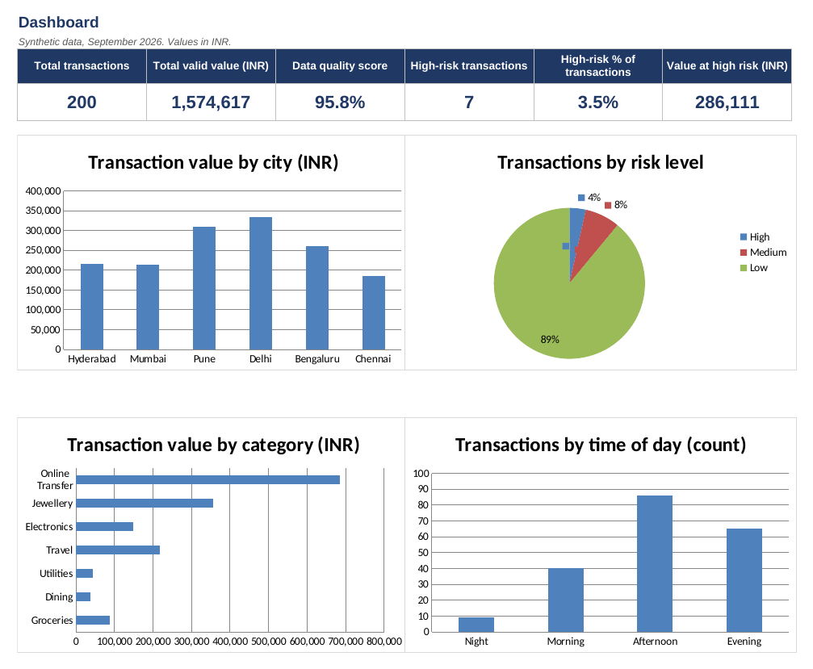

# Transaction Risk & Data Quality Monitor (Excel)

An Excel-based project simulating an Associate Analyst's work in **data validation, transaction monitoring, risk detection and reporting** using 200 synthetic transactions from September 2026.

## Dashboard

## Project Overview

- **Situation:** Transaction data can contain missing information, duplicate records, unusual transaction patterns and potential financial risks.
- **Task:** Analyze 200 transactions to evaluate data quality, identify suspicious activities and summarize findings for stakeholders.
- **Action:**
  - Validated 200 records and checked for missing values, duplicate entries and invalid transaction amounts.
  - Analyzed transaction trends across cities, categories, dates and time periods.
  - Applied 6 risk-detection rules to flag unusual amounts, odd-hour activity, duplicate transactions and other anomalies.
  - Created weighted risk scores to classify transactions into Low, Medium and High categories.
  - Built an interactive Excel dashboard with KPIs, charts and recommendations.
- **Result:** Achieved a 95.8% data quality score, identified 7 High-risk (3.5%) and 15 Medium-risk (7.5%) transactions, and highlighted records requiring further review.

## Key Results

| Metric | Result |
|---|---:|
| Transactions analyzed | 200 |
| Data quality score | 95.8% |
| High-risk transactions | 7 (3.5%) |
| Medium-risk transactions | 15 (7.5%) |
| Transactions flagged by a single rule | 22 |

## Key Activities & Skills Demonstrated

- **Data Validation:** Checked data completeness, accuracy, missing values and duplicates.
- **Trend Analysis:** Compared transaction volume and value across cities, categories and time periods.
- **Risk Detection:** Applied 6 rule-based checks to identify suspicious patterns and anomalies.
- **Risk Assessment:** Used weighted scoring to categorize transactions into three risk levels.
- **Reporting:** Created KPI dashboards, charts and stakeholder summaries.
- **Process Improvement:** Reviewed overlapping alerts and suggested ways to reduce potential false positives.

## Excel Tools & Functions

- **Formulas:** COUNTIFS, SUMIFS, SUMPRODUCT, INDEX, MATCH, IF and IFERROR.
- **Data Management:** Sorting, Filtering, Data Validation and Conditional Formatting.
- **Visualization:** Pivot-style summaries, KPI tracking, charts and dashboards.
- **Reporting:** Risk summaries, findings and recommendations.

## Workbook Structure

- `Transactions` – Transaction records and risk flags.
- `Data_Quality` – Data accuracy and completeness checks.
- `Trends` – Transaction patterns by city, category and time.
- `Risk_Summary` – Risk-level distribution and rule analysis.
- `Dashboard` – KPIs and visual summaries.
- `Findings` – Key observations and recommendations.
- `Assumptions` – Editable risk thresholds and scoring rules.

## Project Limitations

- Used 200 randomly generated synthetic transactions; no real customer or banking data.
- Risk thresholds are practice assumptions, not official fraud-detection policies.
- Suspicious transactions are flagged for review and are not confirmed cases of fraud.

**Project Author:** Ram Vishwakarma
